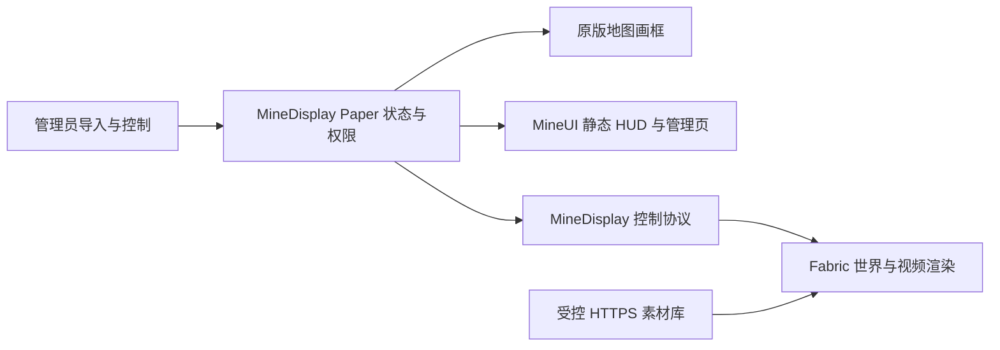

# MineDisplay 技术设计

状态：提案；2026-10-01。没有已实现功能。本文是实施基线，性能数字为初始预算与验收目标，不是实测承诺。

## 1. 需求与范围

支持大厅公告图片、玩家建筑里的画、活动大屏、影院视频、屏幕侧边信息图片与海报轮播。
管理员导入受控素材，再创建屏幕并绑定素材；玩家只接收权限和范围允许的内容。
同一世界屏幕的观看者共享播放进度，迟到加入者定位当前时刻，客户端能力不足时自动显示封面或文字。

首发 M1 只实现静态地图墙；完整目标在 M4 包含可选 mod 视频。首发不含直播、网页嵌入、YouTube 抓取、DRM、任意脚本、玩家自由上传或公网管理后台。
不承诺原版高清电影；原版地图动画为可关闭的实验功能。Folia、Bedrock/Geyser、跨服同步暂不列入兼容承诺。

## 2. 环境与已有能力核查

本地 MineUI/MineAudio 工程均采用 Java 25、Paper `26.2.build.124-stable`，Fabric 目标 26.2。
MineUI 当前业务 API 已有 `open` / `openHud` / `supportsServerUi` / `supportsHud` / `capabilities` / `closeAll`；已有远程图片、域名白名单和纹理预算。
接入只通过 `com.mineui.api`，页面随 MineDisplay jar 发布；客户端图片支持按现有版本门禁核验，不能只判断 mod 存在。
MineUI 当前没有视频节点，也没有任意世界纹理渲染 API。静态 HUD 不再造轮子；世界屏幕与视频属于 MineDisplay 业务。
MineAudio 当前 `com.mineaudio.api.MineAudio` 支持已注册 track 的 play、cue 注册、能力查询；PlaybackHandle 的 seek/pause 是否支持取决于后端。
它没有外部视频时钟与动态 track 注册业务接口，不能假定任意视频音轨可以经现有 API 精确同步。
PackHost 位于 mineUNO，已有 packs ZIP 合并和分发流程，但没有独立公开业务服务 API；只走运维素材交付。

## 3. 后端选择

| 方案 | 优点 | 限制 / 决策 |
|---|---|---|
| 地图 + 固定 ItemFrame | 无 mod、无资源包、图片可动态导入 | 每块 128×128、地图色板、每块实体与 map ID；M1 基线 |
| ItemDisplay + 资源包模型 | 可变换、较少实体、原版兼容 | 纹理预打包、更新需重发包；保留后续静态展示选项 |
| 原版 Painting | 原版外观 | 任意动态素材不适合作为默认机制；不修改注册表 |
| 字符/字体模拟图片 | 可借用文本面板 | 分辨率与资源包耦合、计分板冲突；不采用 |
| Fabric 世界纹理平面 | RGB 高清、任意尺寸、可播放视频 | 需要 mod、渲染/解码适配；M3/M4 主路线 |
| MineUI 图片 HUD | 已有布局、远程图片和生命周期 | 只复用静态图片与控制，不逐帧 PATCH 图片 |

官方 display entity 类型是 block/item/text，不能把 URL 直接赋给实体当任意视频纹理。
地图渲染与现代 Fabric 世界渲染实现需在目标 26.2 的实际依赖上做 M0 原型；旧版 Javadoc 仅说明概念。

## 4. 架构与目录

```text
mineDisplay/
├── docs/                         # 设计、计划、操作规范
├── minedisplay-paper/            # M1：Paper 主插件
│   └── com.minedisplay/
│       ├── MineDisplayPlugin / DisplayManager / DisplayCommand
│       ├── media/               # 素材校验、索引、转换任务
│       ├── render/              # 地图分块与已加载屏幕
│       └── integration/         # 可选 MineUI / MineAudio 业务 API
├── minedisplay-protocol/         # M3：共享消息与限制，无 Bukkit/Fabric
├── minedisplay-client/           # M3：Fabric 渲染、下载缓存；M4 解码
├── tools/                       # M4：离线转码与素材校验
└── deploy.sh                    # 实现后加入，默认仅部署不重启
```

M1 不预建空 protocol/client 模块或多层后端框架。两个真实后端出现后才抽取最小渲染边界。
DisplayManager 持有定义与播放状态；渲染器只消费不可变快照。外部服务仅使用业务 API/事件，不读取兄弟插件内部状态。



控制协议只发屏幕描述、素材摘要、权限和时间轴，不通过 Minecraft 通道发送视频帧。

## 5. 数据模型与持久化

- Media：稳定 ID、类型 image/video、相对源文件、SHA-256、尺寸、时长、封面、派生文件、格式版本、转换状态与失败原因。
- Display：UUID、管理员友好 ID、world UUID、锚点、朝向、宽高、后端 auto/maps/client、素材或播放列表 ID、权限、视距、启用状态、revision。
- 地图记录：每个 tile 的 map ID、行列、受控实体 UUID；地图数据跟随对应世界备份，不支持盲目跨服复用 ID。
- Playback：session UUID、revision、状态、素材 ID、offsetMs、anchorServerMonoMs、速度（V1 固定 1）、loop。观看者集合不持久化。
- HUD：每玩家订阅与本地显示偏好分开；玩家可隐藏，不允许服务器强制覆盖本地选择。

先用带 schemaVersion 的 YAML 定义和 JSON 素材索引，原子写临时文件后 rename；不为小型静态索引引入数据库。
播放中的屏幕重启后恢复为 PAUSED，并持久化最近 checkpoint 的 offset；不把 JVM 单调时钟持久化为可复用绝对时间。
迁移先备份定义；无法识别的新版本拒绝载入并记录原因，不默默清空。素材发布为不可变摘要文件，替换产生新 revision。

## 6. 地图墙实现

M1 限制为竖直墙面、四个水平朝向、整数 tile 尺寸，每 tile 一张地图和一个固定 ItemFrame。
锚点定义为玩家面对墙时左下角 tile 中心，局部 right/up/normal 基向量记录在转换逻辑；所有四朝向需实测无镜像与上下颠倒。
创建前检查全部支撑、空位、世界与实体数量，任一步失败回滚本次生成的实体/记录，不触碰他人实体。
图片先缩放/letterbox 或 crop，再按连续画布分块，量化与可选抖动在工作线程完成，边界不独立抖动以免接缝。
背景填充处理透明像素，默认保持比例。原版色板导致色差须在预览/文档明确。
Bukkit world/entity/map API 均在主线程；地图 render 回调只复制已算好的缓存像素，不做 IO 或图像解码。
地图变更发送按观看者与脏 tile 调度；具体 MapRenderer/sendMap 更新行为在 M0 实测，不预设公开 API 能发送自定义差分包。

实体 PDC 写入插件命名空间、display UUID 和 tile 坐标。禁止受控画框破坏、旋转、取图与爆炸损坏，管理员删除经命令进行。
区块卸载停止渲染，不强制加载世界或保活区块；载入时根据 PDC 和记录幂等对账，缺失修复，重复隔离后清理。
插件停用解除任务与渲染器，持久化实体保留；删除屏幕删除实体与记录，但不删除世界地图文件或尝试复用 Bukkit map ID。
地图 ID 长期增长的运维风险需统计与报警，屏幕换图复用自身 ID。

## 7. 素材导入与分发

M1 接受管理员复制到 `plugins/MineDisplay/media/incoming/` 的 PNG/JPEG；拒绝路径逃逸、符号链接越界、伪造扩展名、过大像素与解码炸弹。
导入后将规范化文件发布为不可变素材，失败不改变现有屏幕。M2 可增加受白名单控制的 HTTPS 导入。
HTTPS 检查 DNS 的每个 A/AAAA、私网/回环/link-local/保留地址；重定向每跳重新检查且最多 3 跳。
限制长度、Content-Type、下载超时与实际解码尺寸；DNS rebinding 防护需连接到已校验地址并保留 TLS 主机验证，不能仅预查 DNS。
服务端和客户端各自校验，客户端不能因“服务器发来的 URL”跳过私网拦截。

M3 媒体站点使用显式配置的 HTTPS base URL，部署到受控静态文件服务/CDN；不硬编码服务器地址，不修改 mineAgent 门户或证书配置。
协议仅允许白名单站点的不可变相对路径与 SHA-256。私有资源使用短期访问票据且日志脱敏，不把长期凭证写入 JSON/仓库。
不提供任意目录浏览、不将 incoming/ 和配置目录暴露。支持连接取消、并发限制、下载临时文件、完成后摘要校验和原子发布。
缓存按 SHA 与转换 profile 区分；损坏缓存删除后最多重试一次，离线则封面/状态提示。

## 8. 高清世界屏幕与 HUD

Fabric 通过目标版本官方渲染 API 绘制面向指定法线的平面，默认世界深度测试、单面、无透墙；近平面、视锥、距离与同世界检查。
从地图墙升级时，服务端按玩家能力隐藏该屏幕的地图实体，mod 只在 READY 后显示平面；失败时恢复地图，避免双重叠加或两者皆空。
若目标版本 per-player entity 可见性无法稳定实现，M3 先发布独立 client 屏幕 + 原版文字封面提示，混合墙模式保留为验收阻塞项。
客户端本地资源预算超过限制时优先显示封面，不无限创建纹理。

静态 HUD 由 MineUI 业务 API 打开，布局锚点沿用 HudLayout；所有动作服务端重新校验权限与 display revision。
没有 MineUI/能力不足时给可点击聊天列表或文字状态，不假装能显示原版任意 HUD 图片。
视频 HUD 由 MineDisplay 自己渲染并提供本地隐藏/音量设置；不假定它能注入 MineUI 组件内部。
HUD 不抢占 MineUI 已有页面，不修改 Bukkit scoreboard；多个视频 HUD 第一版最多一个。

## 9. 视频方案与音频职责

M4 初始输入是本地 MP4；离线工具用 FFmpeg/ffprobe 转为固定帧率、受限尺寸的已验证 profile，生成 manifest、封面与摘要。
首选研究受控 MP4（H.264 8-bit yuv420p、30 FPS 上限、AAC 或独立音轨）；编码器/解码器与操作系统支持在 M0/M4 原型锁定后才能成为交付承诺。
客户端需要真正的解码依赖，不能依靠 Minecraft 自动播放 MP4。选择绑定库前审查体积、许可证/编解码授权、Windows/Linux/macOS 二进制、Java 25 兼容与维护情况。
如果原生解码方案未通过，先交付无声短片的有界预解码帧序列验证；它只是过渡，不宣称高清长视频已经完成。
禁止 Paper 主线程转码；FFmpeg 为管理员离线工具，参数使用参数数组、不经 shell 拼用户输入、限制运行时间和输出尺寸。

解码线程只生成有限数量待显示帧；纹理创建/上传/释放在渲染线程。每个素材共享下载缓存，可见屏幕按需要共享兼容解码时间轴。
音视频以媒体 presentation timestamp 为准；过期帧丢弃不追帧，缓冲失败进入 BUFFERING/ERROR，保留封面。
client 本地解码的视频音轨由 MineDisplay 播放引擎按同一时钟同步；第一版支持静音、音量、距离衰减与离开停止，最多一个有声视频。
这属于视频播放闭环，避免借不支持精准 seek 的后端制造伪同步。与 MineAudio 音乐的优先级协调作为独立 API 需求记录，未获确认前默认不自动暂停他人音乐。
现有 MineAudio 仅用于已注册 cue/track 的可选提示音或预制静态声音，能力不足返回明确降级。

## 10. 播放状态与时间同步

服务端 authoritative 状态：STOPPED / PLAYING / PAUSED / ENDED；客户端另有 LOADING / READY / BUFFERING / ERROR。
PLAYING 的目标位置为 `offsetMs + (serverMonoNow - anchorServerMonoMs)`，暂停保存当前位置；循环取 duration 模，结束一次性转换为 ENDED。
服务端用单调时钟，避免系统时间校正跳帧；不卡在 tick 累计时间，低 TPS 下仍按真实经过时间播放。
客户端通过往返探测估算 serverMono 与 clientMono 的偏移，多样本过滤高 RTT；不直接比较两端本地时钟。
开始允许短暂预缓冲（拟定 1 秒）；迟到玩家定位当前状态，不要求所有人 READY 后才开播。
每 2 秒发状态校准；偏差 <80 ms 忽略、80–250 ms 小幅调整，>250 ms seek/重置。阈值需按实测调整，音频时钟优先。
play/pause/seek/set-media 每次递增 revision；session 变化清空旧队列；异步下载/解码完成必须核验 session+revision，丢弃陈旧回调。
无观看者时默认继续时间轴但不做解码/地图动画；另设 pause-when-empty，恢复时重建 anchor。

## 11. 协议与权限

M3 使用命名空间 `minedisplay:*` 的 Fabric custom payload/Paper plugin messaging，版本与长度严格校验，独立于 MineUI 握手。

| 消息 | 内容 / 用途 |
|---|---|
| HELLO / WELCOME | 协议版本、mod 版本、能力、限制；不兼容回退 |
| UPSERT / REMOVE | screen UUID、revision、世界/几何、素材描述、允许后端 |
| PLAYBACK | session、revision、状态、时长、offset、anchor |
| TIME_PING / TIME_PONG | 估算时钟偏移，不信任客户端指定服务器时刻 |
| READY / ERROR | 素材准备与故障诊断，限频；不是授权依据 |
| ACTION | 管理请求 ID、目标 UUID、revision、动作；服务端验证 |

单消息初始上限 24 KiB，单批最多 16 屏幕，握手 5 秒超时；精确 payload 上限在目标 API 验证。
客户端只收到已授权且在范围内的屏幕；越界发送 REMOVE，重新进入发完整快照。权限改变立即撤销，定期复核。
玩家请求只能引用服务端已有 ID，不允许指定任意 URL/路径或实体 UUID。拒绝未知字段类型、NaN、巨大数值、非法 ID、越权与过时 revision。
播放控制绑定管理员权限，交互射线/距离/世界由服务端验证；客户端命中坐标仅为提示。

## 12. 拟定配置与预算

```yaml
schema-version: 1
media:
  max-source-mib: 32
  max-image-pixels: 16777216
  https-import-enabled: false
  allowed-hosts: []
  base-url: ""                 # M3 必填 HTTPS，空值禁用直连增强
maps:
  max-tiles-per-display: 16
  max-total-tiles: 128
  animated-enabled: false
  animated-max-fps: 2
view:
  range-blocks: 48
  max-visible-displays-per-player: 8
playback:
  pause-when-empty: false
  sync-interval-ms: 2000
client:
  max-image-edge: 4096
  texture-budget-mib: 128
  disk-cache-mib: 512
  max-downloads: 2
  max-video-decoders: 2
  max-video-width: 1280
  max-video-height: 720
  max-video-fps: 30
  max-audible-videos: 1
```

客户端限额是本地硬上限，服务端可以收紧而不能提高到本地上限之外。
720p RGBA 单帧约 3.52 MiB，30 FPS 上传约 105 MiB/s/流；解码环形队列初始最多 3 帧，预算单独计入，不能只统计最终 GPU 纹理。
4×4 地图墙原始色板全帧约 256 KiB；2 FPS×10 玩家约 5 MiB/s，尚未计算包头/压缩。差分收益依内容变化而定，不能预设总是很低。
地图动画另设全服带宽预算（建议 1 MiB/s）和玩家队列上限，预算不足降低 FPS/冻结封面。无声音、无电影体验承诺。
服务端初始限制同时 2 个转换任务、待处理 16 个；达到上限拒绝新任务，不建立无限队列。

## 13. 拟定公开 API

M1 先通过命令和插件内 manager 实现；第二个真实调用方出现时再发布 `com.minedisplay.api`，不提前创建空 API 模块。
入口按既有模式 `MineDisplayProvider.get()`，无服务返回 null；主线程调用，异步素材导入返回有界任务句柄。
候选方法：create(owner, definition)、find(id)、setMedia(id, mediaId)、play/pause/seek/stop、remove、capabilities(player)、closeAll(owner)。
返回明确状态/错误，seek 能力不足不能返回成功。持久化屏幕与 owner 临时屏幕显式区分，owner disable 只自动清理临时对象。
事件候选 DisplayCreated/Removed、MediaReady/Failed、PlaybackChanged；不可变快照、不直接暴露内部集合。

## 14. 可观测性、恢复与测试

status 汇总屏幕数、map/entity 数、观看者、转换队列、客户端能力、预算与版本；debug 显示特定屏幕 revision、同步误差、降级理由。
结构化故障区分 DOWNLOAD / HASH / DECODE / RENDER / PERMISSION / LIMIT，日志无签名 URL、令牌、真实部署地址或素材内容。
缓存淘汰用 LRU + 活跃引用保护；资源释放覆盖离开、换世界、断线、停服、替换素材和解码失败。
删除素材时默认拒绝仍被引用者，管理员先解绑；不删除共享内容仍被引用的摘要缓存。
测试覆盖缩放分块、方向、revision 竞争、时间轴、权限撤销、SSRF 重定向与 IPv6、持久化原子替换和迁移。
集成验收包含无 mod/MineUI only/MineDisplay only/两者并存；实机验证地图色差、区块重载、混合显示和 GPU 资源释放。

## 15. 跨项目需求清单（仅提案）

1. MineUI 通用视频节点若未来有第二个业务需要：能力位、纹理提供者与生命周期 API；当前 MineDisplay 视频 HUD 独立完成。
2. MineAudio 外部时钟/视频音轨与 ducking 仲裁：需要动态音轨注册、时钟绑定、暂停/seek、恢复与优先级；现有 API 不满足。
3. PackHost 独立化或素材托管 API：静态资源包业务需求，不把视频托管塞进资源包下载接口。
4. MineAgent 门户素材上传：后续可单独提案；本次不改门户、账号或外网服务。

以上均不作为 M1 前置；任何兄弟仓库代码改动须另行确认影响、API 和部署顺序。

## 16. 参考依据

本地依据：`../mineUI/README.md`、`../mineUI/docs/DESIGN.md`、`../mineUI/mineui-paper/src/main/java/com/mineui/api/MineUi.java`、
`../mineAudio/README.md`、`../mineAudio/mineaudio-api/src/main/java/com/mineaudio/api/`、`../mineUNO/packhost/src/main/java/com/mineuno/packhost/PackHostPlugin.java`。

- [Paper display entities](https://docs.papermc.io/paper/dev/display-entities/)：实体类型与变换；不是任意视频接口。
- [Paper MapCanvas Javadoc](https://jd.papermc.io/paper/1.21.8/org/bukkit/map/MapCanvas.html)：地图画布概念；版本较旧，26.2 需原型验证。
- [Fabric world rendering](https://docs.fabricmc.net/develop/rendering/world)：世界渲染生命周期；以 26.2 锁定依赖为准。
- [FFmpeg 文档](https://ffmpeg.org/ffmpeg.html)：离线媒体转换；客户端解码依赖另行选型。
